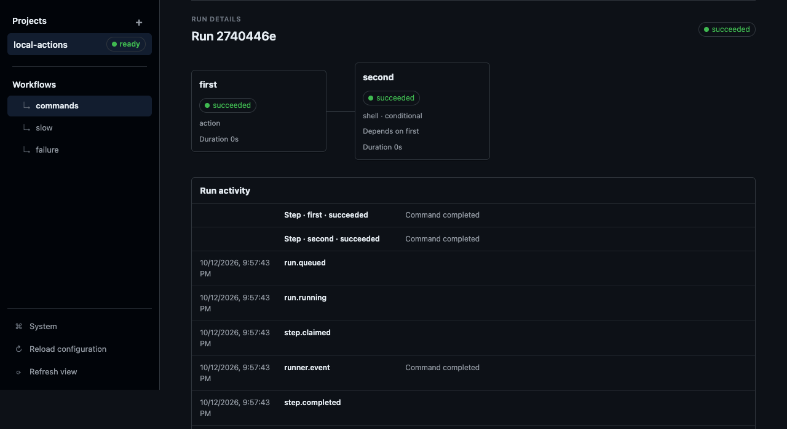
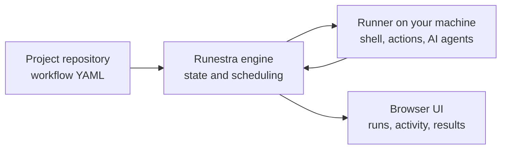

<p align="center">
  <picture>
    <source media="(prefers-color-scheme: dark)" srcset="docs/assets/runestra-mark-mint.svg">
    <source media="(prefers-color-scheme: light)" srcset="docs/assets/runestra-mark-dark.svg">
    
  </picture>
</p>

<h1 align="center">Runestra</h1>

<p align="center">Orchestrate AI agents, shell commands, and Git workflows on your own machines.</p>

<p align="center">
  <a href="https://runestra.app/">Website</a> ·
  <a href="#quick-start">Quick start</a> ·
  <a href="docs/README.md">Documentation</a> ·
  <a href="examples/public-mvp/README.md">Examples</a>
</p>

<p align="center">
  <a href="LICENSE"></a>
</p>



## Why Runestra?

- Define workflows in your Git repository, then inspect runs and results in a browser.
- Execute shell commands, built-in actions, and AI agent steps through runners on machines you control.
- Put human approval steps before commits, pushes, pull requests, and other external changes.

## How it works



The engine serves the browser and coordinates runs. Runners connect to it and
execute workflow steps in their project workspaces.

## Quick start

On macOS or Linux, copy this into a terminal. Requires Git and Bash; the script
installs `uv` when needed, and `uv` supplies Python and the project dependencies.

```sh
git clone https://github.com/runestra-app/runestra.git
cd runestra
bash scripts/quick-start.sh
```

Open [http://127.0.0.1:8765](http://127.0.0.1:8765), click **Continue locally**,
then select **local-actions → commands**. The script starts the engine and runner
and runs the sample. The terminal prints **Sample succeeded** when both steps
finish, and the browser shows the same result.

No Docker, email service, AI account, or API key is needed for this first run.
Keep the terminal open; **Ctrl+C** stops both processes and keeps your data.
For restart instructions and port options, see [Getting started](docs/getting-started.md#start-the-local-sample).

## Try an AI workflow

The [first AI workflow guide](docs/getting-started.md#try-an-ai-workflow) shows a
small read-only example using Codex CLI or Claude Code. The
[maintained examples](examples/public-mvp/README.md) cover manual change requests
and GitHub or Jira issue discovery, with approval before publication.

## Documentation

| I want to… | Read |
|---|---|
| Try the sample, restart it, or add an AI step | [Getting started](docs/getting-started.md) |
| Write a workflow or give the task to an agent | [Workflow guide](docs/workflows.md) |
| Configure imports, inputs, schedules, connections and secrets | [Configuration](docs/configuration.md) |
| Choose an agent profile or a built-in action | [Profiles and actions](docs/profiles-and-actions.md) |
| Install a release or run on a Linux server | [Deployment](docs/deployment.md) |
| Use email login, remote runners, backups or recovery | [Operations](docs/operations.md) |
| Understand security and trust boundaries | [Security](SECURITY.md) |

The [documentation index](docs/README.md) lists user guides and the YAML
reference. Development material is kept separately from the user guides.

## Project status

This quick start runs the current source on `main`. Clean installations on macOS
and Linux and a tagged public release still need acceptance checks.

## License

[Apache-2.0](LICENSE). Third-party dependency licenses and notices are listed
in [THIRD_PARTY_NOTICES.md](THIRD_PARTY_NOTICES.md).
